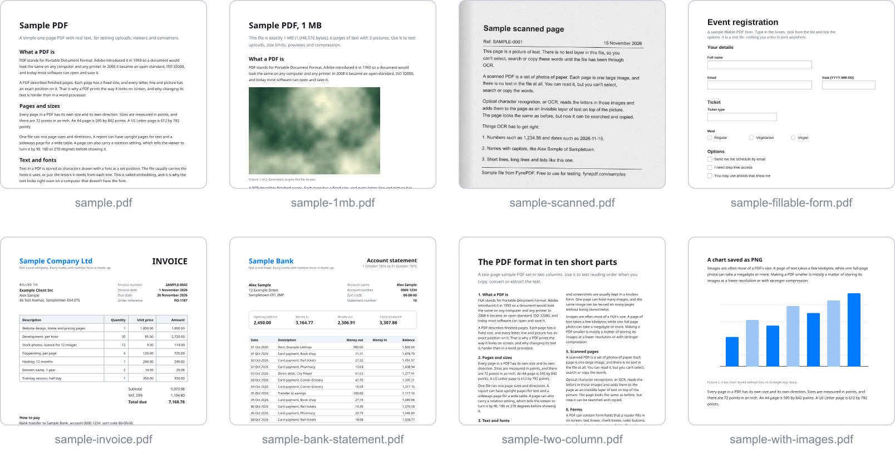

# Sample PDF files

PDFs for testing software that handles PDFs: upload limits, viewers, OCR, form filling, password prompts, repair and table extraction.

Everything in them is made up. There are no real people, companies or account numbers, so you can attach them to a bug report or commit them to a public test suite.



## The files

### By size

For testing a size limit right at its edge. A megabyte here is 1,048,576 bytes.

| File | Size | Pages |
| --- | --- | --- |
| [sample-100kb.pdf](samples/sample-100kb.pdf) | 102,400 bytes | 2 |
| [sample-500kb.pdf](samples/sample-500kb.pdf) | 512,000 bytes | 4 |
| [sample-1mb.pdf](samples/sample-1mb.pdf) | 1,048,576 bytes | 6 |
| [sample-5mb.pdf](samples/sample-5mb.pdf) | 5,242,880 bytes | 10 |

Each one is text with 300 dpi pictures, so a compressor has something to work on. The sizes are exact because of a small unused filler object at the end of the file. Saving a file again in any program changes its size, so keep an untouched copy for limit tests.

### Ordinary documents

| File | What is in it | Size | Pages |
| --- | --- | --- | --- |
| [sample.pdf](samples/sample.pdf) | Plain text with headings | 13 KB | 1 |
| [sample-multipage.pdf](samples/sample-multipage.pdf) | A bookmark for every chapter, and a contents list whose lines link to the pages | 33 KB | 10 |
| [sample-with-images.pdf](samples/sample-with-images.pdf) | Two JPEG photos, a PNG chart and a PNG with a transparent background | 256 KB | 3 |
| [sample-two-column.pdf](samples/sample-two-column.pdf) | Text in two columns, for checking reading order | 19 KB | 2 |
| [sample-sideways-pages.pdf](samples/sample-sideways-pages.pdf) | Pages 2 and 4 are rotated by 90 and 270 degrees (`/Rotate`) | 20 KB | 4 |

### Files that need handling first

| File | What is in it | Size | Pages |
| --- | --- | --- | --- |
| [sample-scanned.pdf](samples/sample-scanned.pdf) | Each page is one 150 dpi JPEG, a little crooked and grainy like a real scan. No text layer. Page 2 has a table. | 373 KB | 2 |
| [sample-fillable-form.pdf](samples/sample-fillable-form.pdf) | An AcroForm with four text fields (one multiline), a drop-down, a radio group and three check boxes | 19 KB | 1 |
| [sample-password-protected.pdf](samples/sample-password-protected.pdf) | Encrypted with AES-128. The password is `fynepdf`. | 13 KB | 1 |
| [sample-damaged.pdf](samples/sample-damaged.pdf) | The cross-reference table is overwritten and `startxref` points nowhere. The trailer is intact. | 14 KB | 2 |

The form's field names are `full_name`, `email`, `date`, `ticket_type`, `meal`, `send_schedule`, `step_free_access`, `photo_consent` and `comments`.

What we saw with the damaged file: qpdf 11 rebuilds the table, writes a good two-page file and exits with code 3 (warnings). pdf.js opens it. pdf-lib 1.17 refuses it.

### Tables

| File | What is in it | Size | Pages |
| --- | --- | --- | --- |
| [sample-invoice.pdf](samples/sample-invoice.pdf) | A ruled table of 7 line items. Subtotal 5,973.98, tax 1,194.80, total 7,168.78. | 15 KB | 1 |
| [sample-bank-statement.pdf](samples/sample-bank-statement.pdf) | 37 transactions with a running balance. Opens at 2,450.00, 3,164.77 in, 2,306.91 out, closes at 3,307.86. | 17 KB | 2 |
| [sample-table-no-gridlines.pdf](samples/sample-table-no-gridlines.pdf) | A spreadsheet export with no cell borders: a header and 15 rows in 4 columns | 37 KB | 1 |
| [sample-scanned-table.pdf](samples/sample-scanned-table.pdf) | A scan of a small ruled table, 3 rows by 3 columns. No text layer. | 22 KB | 1 |

The totals are there so a test can check what it extracted.

### Blank pages

| File | Page size |
| --- | --- |
| [blank-a4.pdf](samples/blank-a4.pdf) | 210 × 297 mm (595.28 × 841.89 pt) |
| [blank-letter.pdf](samples/blank-letter.pdf) | 8.5 × 11 in (612 × 792 pt) |

## Getting them

One file:

```sh
curl -LO https://raw.githubusercontent.com/fynepdf/Sample-PDF-files/main/samples/sample-1mb.pdf
```

All of them:

```sh
git clone https://github.com/fynepdf/Sample-PDF-files.git
```

If a test downloads a file every time it runs, put a commit hash in the address instead of `main`. Then the file can't change under the test.

## Good to know

- The text is real English about the PDF format, not lorem ipsum, so search, summarizing and translation have something to work with.
- Text is set in Noto Sans, embedded as subsets. The form uses Helvetica, which is not embedded, as most forms do.
- Every file except the blank pages carries the line "Sample file from FynePDF" at the foot of each page. In the scans it is part of the picture.
- All files are PDF 1.7.

## Something missing?

If you need a kind of file that isn't here, open an issue and say what you are testing. Right-to-left text, PDF/A and bigger files are the ones we already know about.

## License

[CC0 1.0](LICENSE). Use the files for anything, without asking and without credit. Noto Sans is under the SIL Open Font License, which allows embedding it in documents.

Made by [FynePDF](https://fynepdf.com). We use these to test our own tools.
